<h1 align="center">Hi 👋, I'm Moksh Jhaveri</h1>
<h3 align="center">Software Developer · Full-Stack · AI from Mumbai, India</h3>

  

- 🏆 **12× Hackathon Winner**, including the **OpenAI Codex** hackathon

- 💼 Developer at **Sitepace**

- 🛠️ Previously SDE at **Smowcode** and DB Engineer at **Datalis**

- 💬 Ask me about **full-stack products, AI agents and hackathons**

- 📫 How to reach me **mokshjhaveri554@gmail.com**

  
  

 

---

## Experience

| Where | Role |
|---|---|
| **Sitepace** | Developer (current) |
| **Smowcode** | Software Development Engineer |
| **Datalis** | Database Engineer |

---

## Tech stack

  
   
  

---

## Featured projects

Hackathon projects built with my team.

<table>
<tr>
<td width="50%" valign="top">

### [Forge](https://forge-surfaces-mauve.vercel.app/)
`Winner · Codex Community Hackathon`

Autonomous engineering org in a box. A swarm of Codex agents builds the product in parallel, an eval gate drops the weak attempts, and the best one deploys itself and self-heals.

**Stack:** Agent Swarm · Codex · Eval Gate · CI/CD

</td>
<td width="50%" valign="top">

### EasyOffRoad
`Winner · Hawkathon 2026`

Perception for off-road autonomous vehicles. Semantic segmentation of desert terrain using Mask2Former on a Swin-Large backbone, with test-time augmentation.

**Stack:** PyTorch · Mask2Former · Swin-L · Next.js

</td>
</tr>
<tr>
<td width="50%" valign="top">

### [Fincognia](https://fincogina.vercel.app/)
`Winner · Hackxios 2K25`

Agentic finance co-pilot for gig workers. Predicts liquidity risk with 85% accuracy and acts before an EMI default.

**Stack:** Agentic AI · Forecasting · Python

</td>
<td width="50%" valign="top">

### EcoSort AI
`Winner · Hackniche 4.0`

Real-time computer vision that identifies and sorts plastics.

**Stack:** Roboflow · OpenCV · FastAPI

</td>
</tr>
<tr>
<td width="50%" valign="top">

### [LitAgent](https://litagent.vercel.app/)
`2nd Runner-Up · Hackanova 5.0`

Multi-agent research assistant. A 15-step pipeline over Semantic Scholar, arXiv and PubMed, with an LLM council that cross-checks claims.

**Stack:** LangChain · Multi-agent · RAG

</td>
<td width="50%" valign="top">

### [Equilibrium.ai](https://github.com/MEGH06/Equilibrium.io)
`Runner-Up · Datathon 2026`

Systemic-risk simulation for financial networks.

**Stack:** Python · Simulation · Data Science

</td>
</tr>
</table>

<b>More projects</b>

 

- [**CyberSecure**](https://redact-cybersecure-tau.vercel.app/) (team project): intrusion detection over 1M+ network logs at 99%+ recall, with live PCAP capture, anomaly dashboards and Merkle-tree logging. Scikit-learn, Next.js, Groq

---

## Contributions

  <picture>
    <source media="(prefers-color-scheme: dark)" srcset="https://raw.githubusercontent.com/MJdevs2710/MJdevs2710/arcade/pacman-contribution-graph-dark.svg"/>
    <source media="(prefers-color-scheme: light)" srcset="https://raw.githubusercontent.com/MJdevs2710/MJdevs2710/arcade/pacman-contribution-graph.svg"/>
    
  </picture>

## GitHub stats

  
   
  

